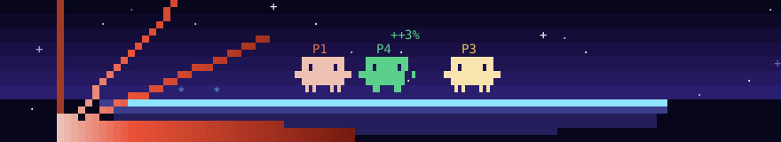
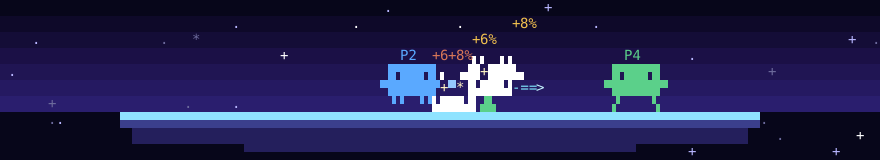

# Clawd Bros

Claude Codeのプロンプト上の帯を「終点」ステージにして、Clawd 4体が大乱闘するmodです。Claudeがツールを呼ぶたびに対応するClawdが技を出し、各Clawdのダメージ%とストックはステータスラインに出ます。





## インストール

Claude Codeをターミナルで起動し、プロンプトに次の1行を入力します。

```
/plugin install clawd-bros --marketplace jnk0vc/clawd-bros
```

マーケットプレイスの追加を聞かれたら`y`、続けてインストール先のスコープを選びます。インストール後に始めたセッションで、帯に試合が出ます。

デスクトップアプリのCodeタブではこのコマンドを使えません。ターミナルでユーザースコープに入れておけば、デスクトップアプリのローカルセッションでも読み込まれます。

## 遊び方

操作は要りません。4体ともCPUで、ツール呼び出しが無い間も歩く・跳ぶ・ジャブを出す・たまに得意技を出す、を繰り返します。Claudeが作業を始めると、使ったツールに応じた技が出て試合が一気に動きます。

| Clawd | 反応するツール | 技 |
|---|---|---|
| P1 WRITE(オレンジ) | `Edit` `MultiEdit` `NotebookEdit` | 横スマッシュ(溜めてから強打) |
| | `Write` | メテオ(跳んで相手の頭上から急降下) |
| P2 READ(青) | `Read` | 3連ジャブ |
| | `Grep` `Glob` `LS` `ToolSearch` `LSP` など | ビーム(飛び道具) |
| P3 BASH(黄) | `Bash` | ダッシュ攻撃 |
| | `BashOutput` `KillShell` `Monitor` など | 回転攻撃 |
| P4 AGENT(緑) | `Agent` `Task` `Workflow` | ミニClawdを召喚して走らせる |
| | `WebFetch` `WebSearch` | つかみ投げ(遠くからワイヤーで引き寄せる) |
| | MCPツール・`Skill`・その他すべて | 回転攻撃 |

- ダメージ%が高いほど遠くへふっとび、画面外へ出るとKOです。出た側の端から扇状のフレアが出ます。
- ツールがエラーになったり拒否されたりすると、その系統のClawdがしばらくピヨります。
- 短い間に6回以上ツールを呼ぶとスマッシュボールが現れます。次のツール呼び出しで拾ったClawdの、その次の技が最後の切りふだ(画面端までのレーザー)になります。
- ストックは3つです。最後の1体になると「GAME!」の後に勝者を表示し、次の試合が始まります。

ステータスラインの表示例です。

```
CLAWD BROS  P1 WRITE 34% ●●●  P2 READ 102% ●●  P3 BASH 0% ●●●  P4 AGENT OUT  ▸ P3 BASH ▸ Bash: DASH
```

## コマンド

| コマンド | 動作 |
|---|---|
| `/clawd-bros` | 一時停止と再開を切り替える |
| `/clawd-bros pause` / `/clawd-bros resume` | 一時停止する / 再開する |
| `/clawd-bros reset` | 新しい試合を始める |

帯は`[-]`(またはctrl+x ctrl+a)で畳めます。

## 描画のしくみ

- ターミナルでは、帯を幅×最大10行のセルグリッド(`Raster`)として描き、10fpsで`$.ui.blit`により差し替えます。帯の高さが7行未満、幅が40列未満のときはステージを描きません。
- デスクトップアプリでは、同じフレームをSVGのドット絵にして5fpsで描き直します。
- 使う文字はASCIIとブロック要素(`▀▄█▌▐▖▗▘▙▚▛▜▝▞▟`)だけです。曖昧幅の文字は使っていないので、日本語環境のターミナルでも列がずれません。

Claude Codeの関数フック(mod)APIはアーリーアクセスで、リリース間で変わることがあります。このmodはClaude Code 2.1.295で作り、同バージョンの`claude plugin test`で確認しています。

## 開発

```
hooks/register.tsx   イベントの配線(タイマー・帯の描画・ツール呼び出しの観測・コマンド)
hooks/engine.ts      試合のシミュレーション(物理・CPUの思考・技・KO)
hooks/render.ts      セルグリッドへの描画と、Raster/SVGへの変換
hooks/model.ts       engine と render が共有する型・座標系・色
types/index.d.ts     $.state に置く値の型
tests/               claude plugin test で動くテスト
```

```
claude plugin validate .
claude plugin test .
```

`tsconfig.json`が継承する`.claude-plugin/types/`は、Claude Codeがこのフォルダからmodを読み込んだときに生成します。型チェックはその後に`tsc -p .`で行えます。
